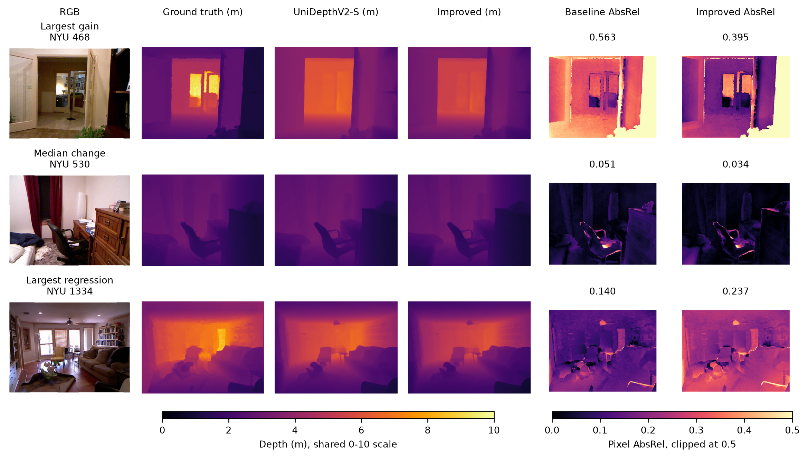
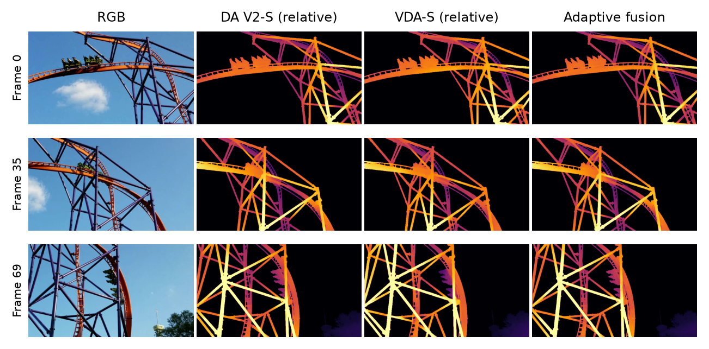

# Independent Computer Vision Project 3

**Metric improvement completed, 2026-11-12.** The selected development-calibrated residual refiner reduces NYU AbsRel by **16.50%** against unchanged UniDepthV2 ViT-S on all 654 test images under the same course protocol. It uses 577 development images for fitting and 218 scene-disjoint images for selection. This is supervised NYU adaptation with frozen foundation weights. [Complete results](results/metric-improvement.json), [selected configuration](configs/metric-final.json), and [small trained checkpoint](artifacts/metric-refiner.safetensors).

The local runs/diagnostics/fusion-difference-slow.mp4 shows a quarter-speed comparison with an amplified absolute prediction-change panel. [Measured change statistics](results/fusion-difference-diagnostic.json) explain why the original comparison appears similar.

An independent implementation of the revised AIAA3201 assignment using official Small pretrained models. The final improvement is **RGB-guided metric residual refinement**. The earlier Direction A study remains as historical evidence. All experiments ran locally on an RTX 4070 Laptop GPU with 8 GB VRAM.

**Status:** required static baselines, video comparisons, fusion ablations, synthetic controls, and repeated runtime measurements are complete. The demo is **provisional**: the linked official rollercoaster source contains 70 real frames, while the brief requests 100. No exported frames were duplicated or invented. Obtain a longer course copy or TA clarification before claiming submission compliance.

This separate checkout lives beside the original `MMDEVC` folder on `feat/independent-performance-search`. Only `independent/` is checked out. No groupmate implementation, parameter choices, caches, or historical results were used as our code or baseline. Common Git ancestry exists for eventual integration by pull request.

## Our measured results

| NYU test metric | Unchanged UniDepthV2-S | Selected refinement |
| --- | ---: | ---: |
| AbsRel | 0.11455 | **0.09564** |
| RMSE (m) | 0.39889 | **0.37080** |
| Delta1 | 0.89222 | **0.91374** |
| Median compute per image | 48.8 ms | 127.3 ms |

The scene-cluster bootstrap 95% interval for relative AbsRel reduction is 12.89%-19.94%. 431 images improve and 223 worsen. The selected method uses the same checkpoint/input resolution and adds 388,001 trained parameters. Its two foundation passes and refinement cost more computation. [Paired image scores](results/metric-residual_refiner-per-image.csv) expose individual regressions. The final configuration/checkpoint were committed at ad3b536 before test evaluation. Earlier baseline results had already been inspected, and this history is disclosed.



Depth colors share 0-10 meters. The final two columns show pixel AbsRel, where darker means lower error. Rows show the largest gain, median change, and largest regression by a fixed automatic rule.

## Initial required baselines and historical temporal study

| Experiment | Result |
| --- | --- |
| Middlebury, all 15 quarter-resolution pairs | 1.895 px mean pair disparity MAE; 75.69% mean valid coverage |
| NYU, all 654 test images, raw metric scale | AbsRel 0.11455; RMSE 0.39889 m; delta1 0.89222 |
| Primary frozen fusion | 18.23% lower temporal proxy; 97.58% baseline-edge strength retained |
| Original full pipeline | 2.77 median FPS, three synchronized trials |
| Secondary efficient configuration | 4.34 median FPS; 16.82% lower temporal proxy; 97.64% edge strength retained |

Video scores measure **stability diagnostics, not metric-depth accuracy**. Aggressive smoothing can lower temporal change while erasing boundaries or delaying true changes. The efficient variant is a disclosed follow-up selected on development data after the initial primary evaluation; both configurations/results remain preserved.



Displays use fixed whole-clip ranges. VDA and DA V2 do not share metric units; fusion shares the unchanged DA V2 display range.

## Read and learn

- [Updated CVPR report PDF](report/independent-report.pdf), [metric source](report/metric-main.tex), [measured values](report/metric-results.tex), and [template attribution](report/TEMPLATE-SOURCE.md)
- [Results, runtime table, and artifact guide](docs/experiments.md)
- [Experiment and decision ledger](docs/execution-ledger.md)
- [Design and exact course protocol](docs/superpowers/specs/2026-11-08-direction-a-design.md) and [implementation plan](docs/superpowers/plans/2026-11-08-direction-a.md)
- Learning stages: [video](docs/learning/01-video.md), [depth inputs/weights/predictions](docs/learning/02-depth.md), [geometry and metrics](docs/learning/03-geometry-metrics.md), [flow/warping](docs/learning/04-flow-warp.md), [fusion/lag](docs/learning/05-fusion.md)

Local deliverables are the updated report, `results/figures/metric-comparison.png`, `results/figures/metric-application.png`, the required videos under `runs/final/`, and `outputs/depth_results_metric_preview.zip`. Raw refined predictions are under `runs/metric-final/`. Foundation weights, datasets, raw caches, videos, and archives stay outside Git. The small independently trained refiner, source, summaries, per-image metrics, report, and figures are tracked.

## Reproduce the metric improvement

Complete the environment and official NYU/UniDepth preparation below, then use the included refiner checkpoint and frozen configuration. A historical baseline cache is optional. This command computes both the baseline and all selected ablations.

```powershell
./.venv/Scripts/python.exe -m depth_project.cli metric-improvement --config configs/metric-final.json --output runs/reproduced-metric
```

Development fitting and selection are implemented by these scripts. They use only the 795 development images and fixed scene split.

```powershell
./.venv/Scripts/python.exe scripts/cache_nyu_development.py
./.venv/Scripts/python.exe scripts/search_metric_refinement.py
./.venv/Scripts/python.exe scripts/train_metric_refiner.py
```

The included configuration and refiner reproduce the reported selection. The training script saves a fresh checkpoint in runs/metric-refiner/ and refuses to overwrite a completed training record. Training kernels can vary across hardware. The complete training curve and development candidate table are tracked.

## Environment

Run commands from **this `independent/` directory**. Tested: Python 3.12.6, torch 2.8.0+cu128, torchvision 0.23.0+cu128, NumPy 2.2.6, OpenCV 4.11.0.86. The exact environment is in `requirements.lock.txt`.

```powershell
uv venv --python 3.12 .venv
uv pip install --python .venv/Scripts/python.exe torch==2.8.0 torchvision==0.23.0 --index-url https://download.pytorch.org/whl/cu128
uv pip install --python .venv/Scripts/python.exe --no-deps -r requirements.lock.txt
uv pip install --python .venv/Scripts/python.exe --no-build-isolation --no-deps -e .
./.venv/Scripts/python.exe -c 'import torch; print(torch.cuda.is_available(), torch.cuda.get_device_name())'
./.venv/Scripts/python.exe -m pytest -q
```

Install CUDA wheels from the official PyTorch index. No foundation-model training is required. UniDepth's optional point-cloud/training CUDA extensions are not needed for our RGB-only inference or course metrics. Its imported visualization utilities require the pinned wandb dependency, but no external tracking service is initialized.

The course GPU is optional and has no documented assessment bonus. Use it for a measured compute constraint or access to a longer course-provided clip.

## Official sources and inputs

Clone these repositories under `third_party/`, then check out the exact revisions in [sources.json](manifests/sources.json):

```powershell
git clone https://github.com/DepthAnything/Depth-Anything-V2 third_party/Depth-Anything-V2
git clone https://github.com/DepthAnything/Video-Depth-Anything third_party/Video-Depth-Anything
git clone https://github.com/lpiccinelli-eth/UniDepth third_party/UniDepth
```

Do not silently modify or update upstream checkouts between runs. Automatic enforcement of clean matching upstream revisions is a documented deferred guard; current checkouts match the recorded revisions. Upstream code and weights retain their licenses and attribution.

| Input | Destination | Official source |
| --- | --- | --- |
| Middlebury input and left GT ZIPs | Extract both into `data/middlebury/`; pairs appear in `MiddEval3/trainingQ/` | [Inputs](https://vision.middlebury.edu/stereo/submit3/zip/MiddEval3-data-Q.zip), [GT](https://vision.middlebury.edu/stereo/submit3/zip/MiddEval3-GT0-Q.zip) |
| NYU labeled MAT | `data/nyu/nyu_depth_v2_labeled.mat` | [Labeled file](https://horatio.cs.nyu.edu/mit/silberman/nyu_depth_v2/nyu_depth_v2_labeled.mat) |
| NYU split | `data/nyu/splits.mat` | [Official split](https://horatio.cs.nyu.edu/mit/silberman/indoor_seg_sup/splits.mat) |
| DA V2 relative Small | `checkpoints/depth_anything_v2_vits.pth` | [Checkpoint](https://huggingface.co/depth-anything/Depth-Anything-V2-Small/resolve/main/depth_anything_v2_vits.pth) |
| VDA relative Small | `checkpoints/video_depth_anything_vits.pth` | [Checkpoint](https://huggingface.co/depth-anything/Video-Depth-Anything-Small/resolve/main/video_depth_anything_vits.pth) |
| UniDepthV2 ViT-S config and safetensors | `checkpoints/unidepth-v2-vits14/config.json` and `model.safetensors` | [Official files](https://huggingface.co/lpiccinelli/unidepth-v2-vits14/tree/main) |
| Videos | VDA's `assets/example_videos/` | [Official examples](https://github.com/DepthAnything/Video-Depth-Anything/tree/main/assets/example_videos) |

Validate files against [assets.json](manifests/assets.json). Direct Hugging Face connections reset, so a mirror served the same official model bytes; all three weight SHA-256 values match published official pointers/file pages. NYU's original-format MAT was obtained through a transport mirror, with its hash, official split, dataset shapes, and first 1 MiB against the university download checked. No preprocessed replacement or groupmate cache was used.

## Reproduce

Use fresh output names: completed baseline caches, final evaluations, benchmarks, and archives refuse to overwrite their files. Existing local results are already present.

```powershell
# Actual source inspection; exit 2 intentionally reports the 70-frame shortfall.
./.venv/Scripts/python.exe -m depth_project.cli inspect-video --input third_party/Video-Depth-Anything/assets/example_videos/davis_rollercoaster.mp4

# Required static baselines.
./.venv/Scripts/python.exe -m depth_project.cli stereo --output runs/stereo-new
./.venv/Scripts/python.exe -m depth_project.cli nyu --output runs/nyu-new

# Unchanged frame-wise and official offline video baselines.
./.venv/Scripts/python.exe -m depth_project.cli baseline --model dav2 --input third_party/Video-Depth-Anything/assets/example_videos/davis_rollercoaster.mp4 --output runs/new/rollercoaster-dav2.npz
./.venv/Scripts/python.exe -m depth_project.cli baseline --model vda --input-size 392 --input third_party/Video-Depth-Anything/assets/example_videos/davis_rollercoaster.mp4 --output runs/new/rollercoaster-vda.npz

# Separate development predictions and bounded search.
./.venv/Scripts/python.exe -m depth_project.cli baseline --model dav2 --input third_party/Video-Depth-Anything/assets/example_videos/Tokyo-Walk_rgb.mp4 --output runs/new/tokyo-dav2.npz
./.venv/Scripts/python.exe -m depth_project.cli sweep --input third_party/Video-Depth-Anything/assets/example_videos/Tokyo-Walk_rgb.mp4 --baseline runs/new/tokyo-dav2.npz --output runs/new/development

# Frozen primary configuration: do not tune it using the final clip.
./.venv/Scripts/python.exe -m depth_project.cli evaluate-video --input third_party/Video-Depth-Anything/assets/example_videos/davis_rollercoaster.mp4 --baseline runs/new/rollercoaster-dav2.npz --video-reference runs/new/rollercoaster-vda.npz --config configs/final.json --output runs/new/final

# Faster flow configuration; all inference/flow/fusion is recomputed.
./.venv/Scripts/python.exe -m depth_project.cli benchmark --input third_party/Video-Depth-Anything/assets/example_videos/davis_rollercoaster.mp4 --config configs/efficient.json --output runs/new/runtime-efficient.json --repeats 3

# Explicitly provisional preview with raw floats and checksums.
./.venv/Scripts/python.exe -m depth_project.cli package --run-dir runs/new/final --output outputs/depth_results_preview_new.zip --allow-short --report report/independent-report.pdf
```

`configs/final.json` is the primary frozen selection. `configs/efficient.json` is the separate follow-up, computing flow at width 320 and rescaling displacements to the output canvas. Preserve its chronology. [The resolution study](scripts/flow_resolution_study.py) reproduces that engineering comparison from the original local development caches; review and commit any newly generated configuration before a secondary evaluation.

Timing includes actual depth inference, both flow directions, and fusion, with two warmups and CUDA synchronization. Decode/resize and disk encoding are excluded. Cached replay is labeled separately. See [original runtime trials](results/runtime.json) and [efficient trials](results/runtime-efficient.json).

## Report and evidence

```powershell
./.venv/Scripts/python.exe scripts/make_figures.py
./.venv/Scripts/python.exe scripts/write_report_values.py
# From report/, use a standard LaTeX toolchain or portable Tectonic:
tectonic metric-main.tex
```

The report uses the official CVPR template. The independent draft uses the configured Git name, Eugene; confirm the final group author line before submission. ArXiv upload is optional under the revised brief.

To regenerate the metric figures and report numbers from a completed run under runs/metric-final/, run scripts/write_metric_report_values.py and scripts/make_metric_figures.py before compilation. The older scripts above preserve the historical baseline/temporal figures. To package the updated metric evidence with the required videos, run scripts/package_metric_preview.py with an unused --output path. The archive retains its explicit 70-frame provisional warning.

Summaries are under `results/`; raw floating-point predictions are under ignored `runs/`. [NYU per-image metrics](results/nyu-per-image.csv) include all 654 images. Failure examples are selected automatically as the three highest test AbsRel images, IDs 468, 87, and 516. Video temporal residuals and edge retention remain proxies because the supplied clip has no depth ground truth.

## Safe Git workflow

Run Git commands inside `CV_Project3_Independent`, not the parent vault or sibling checkout. Stage explicit paths under `independent/` and work on independent feature branches.

```powershell
git branch --show-current
git status --short
git add -- independent/<specific-file>
git diff --cached --stat
git commit -m 'feat: describe one independent contribution'
git push -u origin HEAD:refs/heads/feat/independent-performance-search
```

Local hooks reject commits outside independent branch prefixes, staged changes outside `independent/`, and pushes to shared branches including `main`. They use local `core.hooksPath=independent/.githooks`; they do not install GitHub branch protection and can be bypassed. Use pull requests for eventual integration, without a force push or automatic merge into `main`.
