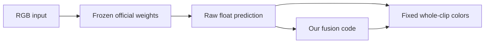

# Stage 2: what the model predicts

Think of a frozen depth model as an experienced photographer judging a scene from a picture. Its past learning is already stored in its weights; our inference code supplies a new RGB picture without changing those weights.

| Role | In this project |
| --- | --- |
| Input | One RGB frame, or an ordered video for VDA |
| Learned parameters | Official pretrained Small-model weights; frozen |
| Prediction | DA V2/VDA: relative depth scores; UniDepthV2: depth in meters |
| Ground truth | Middlebury disparity or NYU filled depth; unavailable for rollercoaster |
| Our chosen parameters | Flow settings and confidence/fusion thresholds; selected on development data |

A relative prediction of 10 next to 20 does not establish distances of 10 m and 20 m. DA V2's larger scores generally indicate nearer regions. A separate metric model produces quantities such as 2 m and 4 m; we compare those directly with NYU's meter-valued ground truth.

The video pipeline has two separate ideas: the pretrained network predicts scene structure, and our new code decides how much aligned history to retain. We do not claim to have trained the pretrained network.

Each video's display range is computed over the whole clip. DA V2 and its fusion variants share one range. VDA has its own fixed range, so colors between these two separately trained relative models do not imply shared meters.

Learning checkpoint: identify which quantities are inputs, learned weights, predictions, and labels, and explain why our relative-depth video cannot establish metric accuracy.
