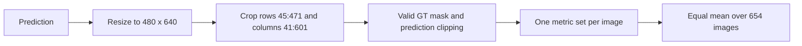

# Stage 3: geometry and evaluation by hand

Imagine measuring distance by how far a nearby object shifts when you alternately close each eye. A larger stereo disparity usually means a nearer object.

Our simplified worked example has focal length 1000 pixels, baseline 100 mm, and a calibration offset of 2 pixels. OpenCV returns raw disparity 160; divide by 16 to obtain 10 pixels. Then depth is `1000 * 100 / (10 + 2) / 1000 = 8.3333 m`. The final division converts millimeters to meters. Changing disparity to 9 pixels gives 9.0909 m; changing it to 11 gives 7.6923 m. Disparity error changes distance nonlinearly.

For a second, separate toy example, NYU ground-truth distances are `[1, 2] m`, and a metric model predicts `[1, 2.4] m`:

1. Absolute errors: `[0, 0.4] m`.
2. Relative errors: `[0/1, 0.4/2] = [0, 0.2]`; their mean AbsRel is `0.1`.
3. Squared errors: `[0, 0.16]`; RMSE is `sqrt(0.16/2) = 0.28284 m`.
4. Prediction/GT ratios, taking the larger direction: `[1, 1.2]`. Both are strictly below 1.25, so delta1 is 1.0.

The predictions are the model outputs; the ground-truth values are the labels. We never fit their scale on test labels.

The crop is 426 rows by 560 columns. NumPy indexing uses row/y first, column/x second. MATLAB's image ID 1 becomes Python index 0. These details affect the reported result even with identical model weights.

Middlebury's PFM scale magnitude is not multiplied into its pixel-valued disparity samples. The first real-data smoke test caught this mistake; the dedicated regression test keeps it from returning.

Learning checkpoint: calculate the two toy examples, explain each denominator, and explain why excluding invalid predictions must be accompanied by a coverage number.
