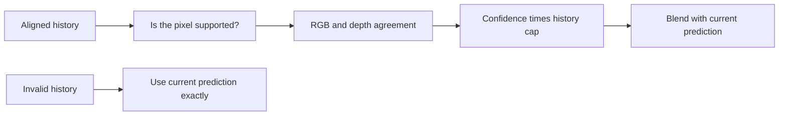

# Stage 5: how much history deserves a vote?

Imagine averaging two thermometer readings, except the older reading belongs to a moving object. First align it to the same object; then decide whether it is still trustworthy.

In our simplified relative-depth example, today's score is 10 and aligned history is 12. If the actual history weight is 0.25, the output is `0.75 * 10 + 0.25 * 12 = 10.5`. If history is occluded, its weight is zero and output is exactly 10.

The selected maximum history weight is 0.75, but this is a cap, not the weight everywhere. For example, confidence 1/3 gives actual weight `0.75 * 1/3 = 0.25`. Photometric mismatch, depth disagreement, and forward-backward rejection reduce history's influence. These confidence values are heuristic reliability signals, not learned or calibrated probabilities.

The state stores the previous fused map, so older information can persist recursively. The method is causal: it never needs a future RGB frame. The official offline VDA reference uses a different, multi-frame inference procedure.

Too much history creates lag. When truth jumps from 2 to 10 and a naive average keeps 75% history, its first output is `0.25*10 + 0.75*2 = 4`, still 6 below the new truth. A frozen output can even obtain zero temporal change while being entirely wrong. This is why we report motion response, edge retention, synthetic ground-truth error, and runtime alongside the real-video temporal proxy.

Learning checkpoint: reproduce both calculations and explain why the strongest smoothing ablation is not automatically the best method.
