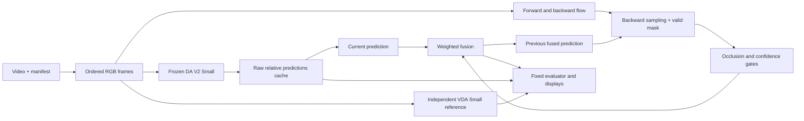

# Independent Direction A: proposed design

Date: 2026-11-08, Asia/Hong_Kong. Status: proposed for review; implementation has not started.

## Intent and success

Build the revised Project 3 independently, retaining Direction A as the single improvement. The user wants visible GitHub contributions, strong defensible performance, and the ability to explain the complete pipeline. Preserve the sibling `MMDEVC` checkout and use feature branches throughout.

Success means complete required baselines, a reproducible improvement comparison with honest tradeoffs, clear report/demo artifacts, and an implementation the user understands. A lower temporal-change number alone is insufficient: blurred boundaries, motion lag, or a frozen depth map must not count as success. Performance gains are hypotheses to test, not promised results.

## Authoritative assignment

Use the newly supplied `Project_3__Monocular_Metric_Depth_Estimation_and_Video_Consistency.pdf`, SHA-256 `ea65076917e87febb0c3c67773b9fc6edf304e2821a74266a03f22ef33abc226`. Its cover says Spring 2027; its contents match the revised scope described in the handover. The older Fall 2026 PDF is superseded. Relevant requirements were read across all five pages.

| Requirement | Exact implementation obligation |
| --- | --- |
| Stereo | All 15 Middlebury trainQ pairs; quarter-resolution calibration; OpenCV disparity divided by 16; depth in meters `f * baseline_mm / (disparity_px + doffs) / 1000`; exclude invalid disparities. |
| Stereo evaluation | Mean absolute disparity error and prediction coverage on finite, positive ground-truth disparities; state the prediction-validity rule and both denominators. |
| Frame-wise model | Depth Anything V2-Small on the required video's first 100 original-rate frames; outputs are relative depth, not meters. |
| Metric model | UniDepthV2 ViT-S, RGB-only `infer(rgb)`, checkpoint `lpiccinelli/unidepth-v2-vits14`; no test-set scale fitting. |
| NYU inputs | Official labeled MAT and splits; 795 development and 654 test images; MATLAB indices minus one; HDF5 RGB `images[i].transpose(2,1,0)`, filled depth `depths[i].T`. |
| NYU protocol | Resize predictions to 480 x 640; Python crop `[45:471, 41:601]`; GT valid in 0.001-10 m; clip predictions to that range; equal per-image means across all 654; AbsRel, RMSE, delta1. Record strict/inclusive endpoint handling and test it. |
| Video model | Video Depth Anything-Small, relative, offline, default FP16; initial flags `--encoder vits --max_len 100 --max_res 640 --save_npz`; reduce input size only for measured memory limits and report it. |
| Fair video displays | Same frame IDs, frame rate, palette, output canvas; fixed per-method normalization over the entire clip. Use the unchanged frame-wise baseline's normalization for its fusion variants. Colors across different models do not imply common metric scale. |
| Part 3 | One improvement: flow-guided fusion. The revised instructions explicitly allow video improvements to use controlled qualitative comparisons plus runtime; no annotated video collection is required. |
| Submission | 6-8 CVPR pages excluding references, public GitHub, `depth_results.zip`, RGB/depth comparison, one simple application, three difficult cases actually present in the supplied data. Cite the listed reading and borrowed components. ArXiv and additional datasets/clips are optional. |

The sentence requesting a metric-model/improvement comparison is interpreted together with the explicit video-improvement allowance in Part 3: report the unchanged UniDepth NYU baseline and assess Direction A on videos. Do not apply temporal fusion to the unordered NYU image test set or claim it improves NYU accuracy.

## Approaches considered

1. **Recommended: Small pretrained baselines plus independently written causal flow fusion.** Meets the assignment, fits a local-first workflow, and provides clear ablations and learning stages.
2. **RAFT everywhere from the start.** May improve difficult motion, but costs memory/runtime and makes initial debugging harder. Evaluate RAFT-Small as a later flow-backend comparison after Farneback is correct.
3. **Fine-tune a depth foundation model.** Adds training/data complexity without a specific hypothesis or assignment requirement. Exclude from this project plan. Likewise, do not scale to Base/Large depth models: the revised resource rule says to use Small.

## Isolation and integration

Physical layout:

```text
Project/
  MMDEVC/                        existing checkout; untouched
  CV_Project3_Independent/        separate Git checkout
    .git/
    independent/                 all our tracked contributions
      README.md
      AGENTS.md
      docs/
      .githooks/
      ...                        implementation added after plan review
```

This is a separate clone with independent Git metadata, not a worktree sharing mutable configuration. Sparse checkout materializes only `/independent/`; the group's code is not used or checked out. Common ancestry enables a future PR containing additions under `independent/`. Base: remote `main` commit `c6c831426b7f869a0c3170569cf05219abde6237`; working branch: `feat/independent-direction-a`. No remote branch has been created by setup. Local hooks reject main commits/pushes; GitHub protection itself is unchanged.

## Architecture



The pretrained networks remain frozen. New code handles video I/O, model adapters, warping, masks, fusion, evaluation, and reporting. Cached baseline outputs make fusion ablations cheap; end-to-end timing must still include baseline inference and both flow directions. Load models sequentially on the 8 GB GPU rather than retaining all networks in memory.

### A concrete fusion example

Think of putting yesterday's tracing paper over today's photograph: move it into alignment before averaging. In a toy example, today's relative prediction at a tracked pixel is 10 and the aligned previous value is 12. With history weight 0.25 the fused value is `0.75 * 10 + 0.25 * 12 = 10.5`. If that pixel is newly revealed, history weight is zero and output is 10. These are arbitrary relative values, not distances in meters. Optical flow supplies alignment; the confidence gate decides whether history deserves a vote.

### Motion and fusion contracts

- At current pixel `p`, use backward flow `b_t(p)` from frame t to t-1 to gather historical depth at `p + b_t(p)`. Do not pass forward flow directly to a gather operation.
- For forward-backward checking, sample forward flow at that same historical coordinate and compare `b_t(p) + f_(t-1)(p + b_t(p))` against a documented magnitude-aware threshold.
- Mask out-of-bounds, non-finite, and inconsistent history before fusion. Invalid history yields the current prediction. No wrapping, reflected fake support, or propagation through a scene cut.
- Upsampled flow must scale its x and y components by the actual width and height resize ratios. RGB uses its native model preprocessing; cached depth and flow have explicit source/target sizes and conventions.
- Form a bounded history weight from consistency, photometric agreement, and optional current/history relative-depth disagreement. These are heuristic reliability signals, not calibrated uncertainty probabilities.
- Start with two-frame history and no scale fitting. A robust positive affine history-to-current fit using only reliable predictions can be tested as an optional fusion ablation if relative-scale mismatch is visible. It never uses ground truth, never converts to metric depth, and can erase real depth change; keep it disabled unless the development evidence supports it.
- A scene-cut detector resets history. Its threshold is fixed using development material or synthetic transitions, not the final clip's preferred result.

## Experiment design and performance policy

Implement incrementally: unchanged baseline; naive EMA; flow-aligned fixed-weight fusion; occlusion rejection; adaptive confidence. Add the alignment ablation only if justified. Video Depth Anything is an independent pretrained reference, not a module credited as our improvement. These methods will have our own names/configurations; the group's E0-E5 labels/results are not reused.

Mandatory clip: first 100 decoded frames at original FPS. The handover reports a 70-frame version; independently count the official source. If fewer than 100 exist, preserve the hash/count, process only genuine frames, label the shortfall, and obtain course clarification before calling the submission compliant. A different GPU cannot create missing frames. Never loop, interpolate, or duplicate frames to reach 100.

Use an optional official example clip for development and reserve rollercoaster for the final comparison. Optional here means it supports scientific separation, not that it becomes a new course requirement. If only the mandatory clip is available, use synthetic controls to select settings and label real-clip observations exploratory. Do not silently tune on final frames and call them held-out results.

Candidate search: first vary history cap over `{0.25, 0.5, 0.75}` and two consistency strengths on a short development excerpt. Only if confidence adds measurable value, test two disagreement strengths, for at most 12 Farneback candidates total. These are untested starting hypotheses chosen here, not borrowed parameters. Keep the best 2-3 tradeoff candidates for full development runs. Compare RAFT-Small against the best fixed fusion configuration separately; do not rerun the whole grid by default. Freeze settings and commit the configuration before final evaluation.

There is no promised percentage gain or FPS. Select a method on a development tradeoff: lower flicker with preserved responsiveness/boundaries and acceptable latency. Report failures and simpler winning ablations. Additional GPU time is useful only when it answers an unresolved experiment question.

## Evaluation and safeguards against misleading scores

1. Required outputs: synchronized baseline/reference/fusion videos; fixed ranges; same displayed frames; zooms at moving boundaries; one background-blur application; three observed difficult cases.
2. Required efficiency: baseline-only, flow, fusion, and full-pipeline latency; hardware, input sizes, precision, peak allocated and reserved CUDA memory; separate cold start, warm inference, disk decode/encode, and cached replay. Synchronize CUDA around timed work; repeat warmed runs and report median and spread.
3. Optional temporal proxy: a frozen evaluator computes flow and non-occlusion masks once per clip, independent of candidate-specific confidence. Score every candidate on identical frame pairs/pixels. Report support coverage; a method cannot improve by discarding its hard pixels. Record the evaluator's own flow backend and bias toward related flow methods.
4. Avoid normalization tricks: no per-frame display normalization, no candidate-specific temporal-score normalization, no per-frame post-hoc scale fitting inside a headline score. Report raw within-backbone change and any explicitly defined sequence-normalized diagnostic separately. Do not rank unrelated relative-depth models using arbitrary raw magnitudes.
5. Synthetic controls: static noisy depth, translating foreground edge, disocclusion, genuine depth step, and scene cut with known truth. Measure noise reduction, edge/ghosting error, and settling delay. Include constant/frozen-depth negative controls: a temporal score alone must expose its inability to certify quality.
6. Interpret real-video evidence carefully: optical flow aligns image correspondences but cannot compensate true depth changes caused by 3D camera/object motion. A temporal residual can penalize valid changes. RGB-edge alignment and baseline-edge retention are proxies, not ground-truth depth accuracy. No metric-accuracy claims on the unannotated clip.
7. NYU metric code is independently checked with exact hand-computed cases and all required protocol details. Keep zero/non-finite handling explicit; fail a run on non-finite model output instead of silently dropping difficult predictions.

## Reproducibility and deliverables

Each run records Git SHA and dirty state, resolved configuration, upstream commit/checkpoint hashes, data hashes, ordered frame/image IDs, seed, package/device versions, precision, sizes, and execution/timing mode. Cache keys include every preprocessing/model input that changes predictions. Never reuse incomplete or incompatible caches silently.

Outputs include raw float predictions, compact CSV/JSON summaries, controlled ablation figures, failure panels, a flow/warp/confidence visualization, a simple background-blur comparison, the CVPR report, and a verified submission archive. Dependencies and large artifacts remain outside Git; small reproducible evidence is tracked deliberately.

## Learning checkpoints

1. Decode and inspect video; explain BGR versus RGB and real frame counts.
2. Predict one frame; distinguish RGB input, frozen weights, relative prediction, and unavailable video ground truth.
3. Trace a moving pixel and the backward warp; test identity and translation.
4. Explain why a newly visible pixel must reject history.
5. Compute the toy fusion by hand, then explain confidence and lag.
6. Explain why smooth videos do not prove metric accuracy and why NYU requires a separate metric model.
7. Reproduce one result from a fresh command and explain both a success and a failure.

## Official references consulted

- [Depth Anything V2](https://github.com/DepthAnything/Depth-Anything-V2): official Small model and relative-depth inference.
- [Video Depth Anything](https://github.com/DepthAnything/Video-Depth-Anything): official video model, offline flags, and relative/metric modes.
- [UniDepth](https://github.com/lpiccinelli-eth/UniDepth): official UniDepthV2 model loading and RGB inference.
- [OpenCV optical flow](https://docs.opencv.org/4.x/d4/dee/tutorial_optical_flow.html) and [remap geometry](https://docs.opencv.org/4.x/da/d54/group__imgproc__transform.html): flow and destination-to-source sampling.
- [Torchvision RAFT-Small](https://docs.pytorch.org/vision/stable/models/generated/torchvision.models.optical_flow.raft_small.html): optional later flow backend. Pin the actual installed compatible torch/torchvision versions at implementation time.

The course PDF governs assignment details even where upstream defaults differ.
