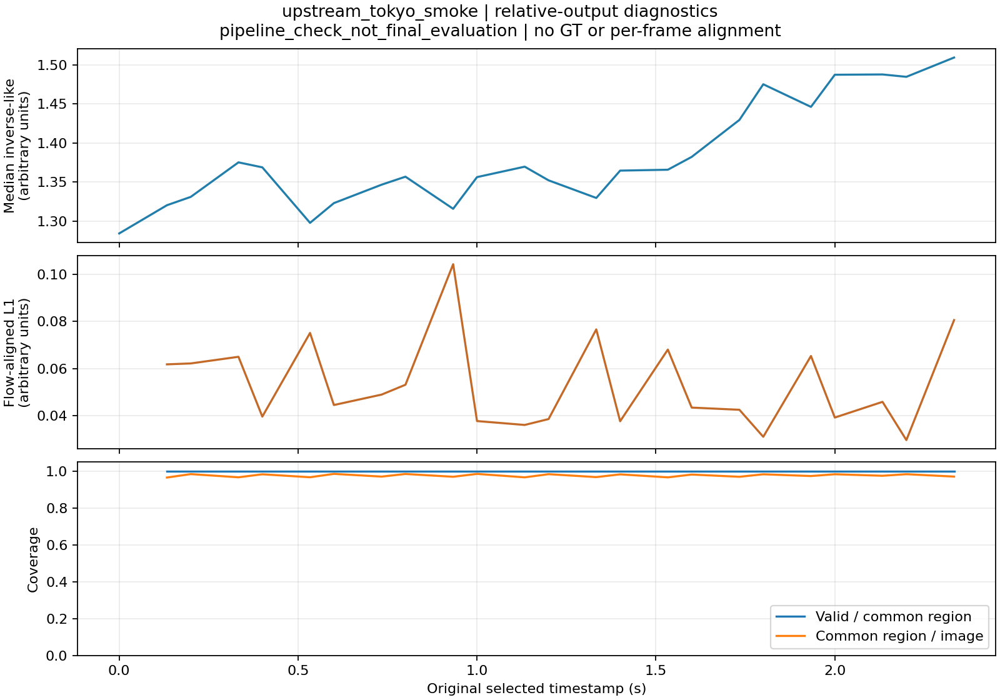

# Part 1 相对深度视频诊断

2026-10-28：DA V2 Small relative 在同一个公开视频 24 帧缓存上完成 GPU FP16 推理，实际 encoder 为 364×644，输出为 180×320。推理约 0.905 秒；这只是短片程序检查，不是正式视频性能结论。相对预测保留原始 inverse-depth-like 数值，没有 GT 或逐帧尺度拟合。

复用了米制实验的同一个 RGB 光流和公共区域：23 对帧、1,293,996 个参考像素，预测对覆盖率 100%。相对原值的 flow-aligned L1 为 0.053257 arbitrary units；按整段固定 1%–99% 跨度 6.595064 归一化并截断后，固定分母误差为 0.008075。后者是本项目用于展示变化量的诊断，不是公认 benchmark 成绩；不能与米制 RMSE 或 L1 数值直接比较。

逐帧中位数从 1.284443 变到 1.509148。视频有相机和物体运动，因此这个变化混合了场景变化与模型输出变化，不能直接解释为真实尺度漂移。原始数组的逐帧中位数与 CSV 的像素加权汇总已分别复算。该片段不是静止场景，`static_pixel_std_relative` 正确保持为空；真实静止片段上的闪烁测量仍待自录素材。

诊断明确允许有限的零值和负值，因为相对输出不是物理米制深度。全部值相同或全部无效时，归一化跨度不可用，相关指标为空，不伪造为零误差。解析测试覆盖已知变化、任意正比例/平移变换、非默认时间间隔和无效预测的固定分母惩罚。

完整浮点数组与固定色标 MP4 保留在本地：`outputs/video_smoke_20261028/dav2_relative_gpu_364/`、`outputs/relative_video_diagnostics_20261028/`。已渲染检查诊断图及首/中/末帧预览；MP4 重新解码的帧数与原时间戳一致。精选 CSV、JSON、图片位于同名结果目录。正式操作见 [相对视频诊断](../docs/relative_video.md)。
