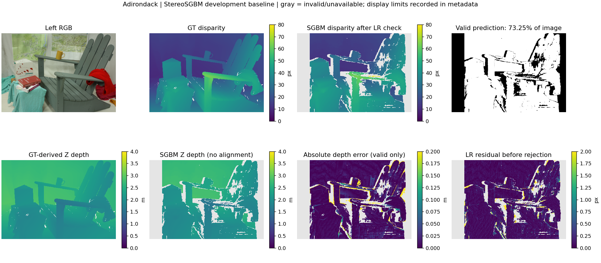

# Adirondack StereoSGBM 首次基线 · 2026-10-20

已跑通单样本流程：左右 RGB → 灰度 StereoSGBM → 显式左右一致性检查 → 米制 Z 深度 → 原始数组/有效 mask → 指标与可视化。运行使用 CPU，无需 GPU。

这是 **Adirondack 开发样本上的初始固定参数结果**，不代表其余场景表现。未进行参数搜索或 GT 尺度对齐。B / Jun Yu Eugene YIP 的独立复现仍待完成。

## 可追溯运行

- Run ID：`stereo_Adirondack_20261020_baseline`。
- 代码提交：`9b274e66c1117979c65d6dc056fef333c7b3f6e4`；运行时工作树干净。后续结果记录提交不改变本次实现。
- 输入：Middlebury v3 trainingQ，Adirondack，718 × 496；manifest split=`dev`。
- 配置：[输入配置](../configs/stereo_sgbm.yaml)、[实际参数](runs/stereo_Adirondack_20261020_baseline/config_resolved.yaml)。匹配整数候选 0–79 px，block size=5，P1=200，P2=800，LR 阈值=1 px。
- 详细记录：[metadata.json](runs/stereo_Adirondack_20261020_baseline/metadata.json)，含原始输入、实现与输出的 SHA-256。该记录内产物路径相对于原始 run 目录。
- 完整本地产物：仓库内 `outputs/stereo_Adirondack_20261020_baseline/`；原始浮点预测没有上传，B 需用相同数据复跑或另行约定共享位置。
- 环境：Windows 11，Python 3.13.5，opencv-python 4.13.0.92（cv2 4.13.0），NumPy 2.1.3、Pillow 11.0.0、PyYAML 6.0.2、Matplotlib 3.9.2。OpenCV 单线程、OpenCL 关闭。

## 结果

| 指标 | 全部有效 GT | 非遮挡 GT |
| --- | ---: | ---: |
| GT 区域像素数 | 354,918 | 325,114 |
| 有效预测像素数 | 260,077 | 254,709 |
| 预测覆盖率 | 73.2781% | 78.3445% |
| 无效预测比例 | 26.7219% | 21.6555% |
| 视差 Bad >1 px，含无效惩罚 | 32.8532% | 26.9419% |
| 视差 Bad >2 px，含无效惩罚 | 29.9503% | 23.8892% |
| 视差 MAE，有效预测内 | 0.89418 px | 0.66204 px |
| 深度 AbsRel，有效预测内 | 0.009963 | 0.007412 |
| 深度 RMSE，有效预测内 | 0.101455 m | 0.077884 m |
| 深度 RMSE-log，有效预测内 | 0.044547 | 0.034379 |
| 深度 δ1，有效预测内 | 98.6093% | 99.1202% |

**RMSE / AbsRel / δ 只描述有预测的像素，必须与 coverage 一起看。** Bad1/Bad2 的分母始终为固定 GT 区域，无效预测计为错误。没有剔除图像边缘或按预测 mask 缩小 GT 区域。完整精度字段见 [CSV](tables/stereo_Adirondack_20261020_baseline.csv) 与 [JSON](runs/stereo_Adirondack_20261020_baseline/metrics.json)；公式见 [评测口径](../docs/stereo_baseline.md)。

测得一次 CPU 预测耗时 **0.094628 s**，预热 1 次、测量 1 次，包含双向匹配、LR 和深度转换，不含 I/O、评测和绘图；这不是稳定性能 benchmark。



图中左右边缘存在搜索范围造成的无效带，椅背、扶手和遮挡边界也有空洞及误匹配。显式 LR 检查不能排除所有双向一致的错误。深度图与 GT 共用固定米制色标，空洞保留 NaN；没有为改善外观而填洞。误差图只显示可评估预测，灰色区域需结合 mask 与覆盖率理解。

## 已验证与复现

已通过：22 项单元/合成匹配测试、仓库结构检查、保存后 shape/dtype/NaN/mask 检查、定点视差除以 16 与米制公式的独立验证。独立解析原始 PFM 后复算 coverage、RMSE 和 Bad1 与保存表一致；5 个输入文件哈希与先前的数据检查相同。试跑和干净提交上的运行得到相同数组、指标、预览图；已有输出目录拒绝覆盖。

```sh
git fetch origin
git switch feat/stereo-baseline
python -m pip install -e ".[data,stereo]"
python -m unittest discover -s tests -v
python scripts/run_stereo_baseline.py --sample Adirondack
```

运行前按 [数据准备说明](../docs/middlebury_data.md) 放置输入/GT，并配置本机 `configs/paths.local.yaml`。若本地没有该分支，使用 `git switch --track origin/feat/stereo-baseline`。默认命令创建新的输出目录；无需重用本次 run ID。

下一步由 B 交叉复现；A 再确定其余 Middlebury 场景划分与 NYUv2 读取规范。扩展到多方法时，不能仅按各自有效预测的 RMSE 排名，必须保持共同 GT 区域并共同报告失效情况。
