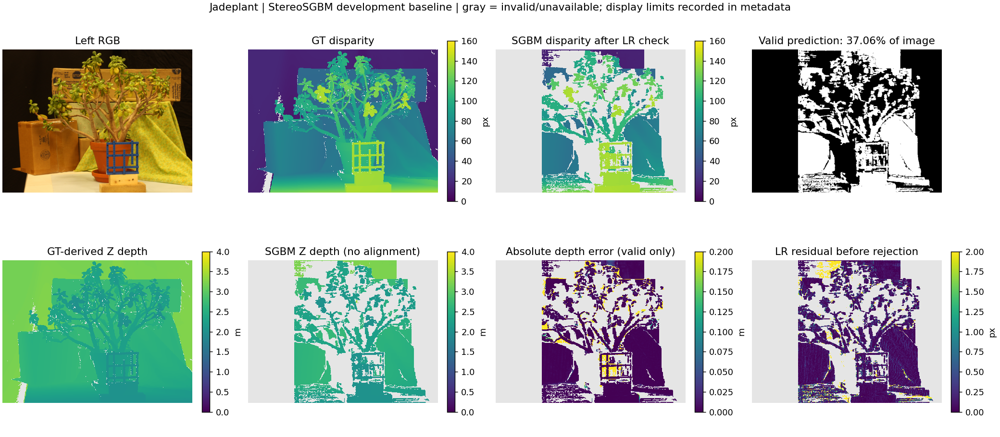
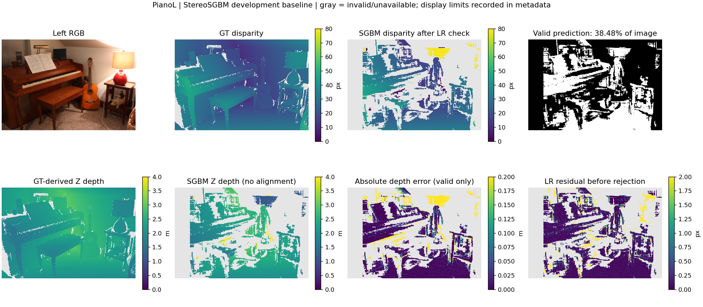
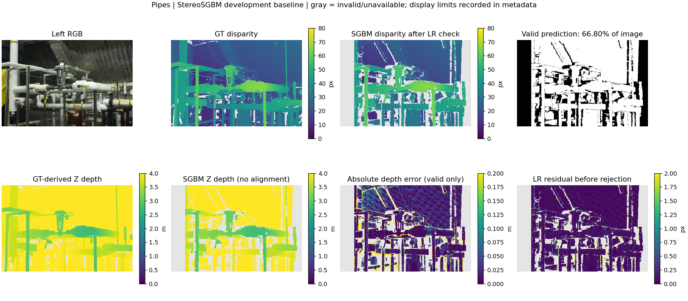

# Week 1 StereoSGBM：15 对结果

固定配置：`configs/stereo_sgbm_selected.yaml`，block size 3、P1=72、P2=288、左右一致性阈值 1 px。仅在 Adirondack、Pipes 两个开发场景比较 5/3/7 三组 block size；其他 13 场景没有参与参数选择。[调参表](tables/stereo_tuning_week1.csv)、[逐场景表](tables/stereo_week1_per_scene.csv)、[汇总表](tables/stereo_week1_summary.csv)、[运行来源](stereo_week1_provenance.json)。

| 范围 / GT 区域 | 场景数 | 像素加权 coverage | Bad>1 px（含无效） | 场景平均 RMSE（仅有效预测） |
| --- | ---: | ---: | ---: | ---: |
| evaluation / all-GT | 13 | 61.26% | 46.38% | 0.1201 m |
| evaluation / nonoccluded-GT | 13 | 67.14% | 39.87% | 0.1016 m |
| 全部 / all-GT | 15 | 62.65% | 44.73% | 0.1498 m |

全部 15 对含开发场景，只作描述性汇总；evaluation 也是有 GT 的 trainingQ 子集，不是 Middlebury 官方隐藏测试。低条件 RMSE 不表示整幅图准确：evaluation 仍有 38.74% GT 像素没有有效预测。GT 区域固定，没有填洞或用模型 mask 缩小分母。

## 三个可定位的失败例子

下图灰色表示无效/不可用。图上 mask 标题的百分数以**整幅图**为分母，下表与指标表 coverage 以**固定 GT 区域**为分母，两者不同。深度显示固定 0–4 m，误差显示固定 0–0.2 m；超出上限只是颜色饱和，原始数组和指标不裁剪。

| 场景 | all-GT coverage | 条件 RMSE | 可直接观察到的现象 / 解释边界 |
| --- | ---: | ---: | --- |
| Jadeplant（evaluation） | 37.39% | 0.1291 m | 叶片、细枝和前景格架周围缺失明显；视差边界附近误差与 LR residual 较大。细结构、遮挡与匹配窗口跨深度边界是可能原因，未做逐因素消融。 |
| PianoL（evaluation） | 39.42% | 0.3594 m | 墙面、灯及部分琴凳区域大面积无效；仍存活的一些墙面匹配明显错误。弱纹理/照明差异是候选解释，LR 检查无法清除所有错误匹配。 |
| Pipes（dev） | 67.66% | 0.5913 m | 管道边缘和交叠处有缺失，背景与远处区域误差明显。深度超过 4 m 的区域在图中饱和，需看原始值；由 Z=fB/(d+doffs) 可知远处深度对视差误差更敏感，但不能只凭颜色判断误差大小。 |





## 复算

完整原始数组在本地 `outputs/stereo_all_week1_20261021/<scene>/`；源代码 commit 为 `6090a01a29825ecf9158eed8a2ae87d8f299f57e`，运行时工作区干净。

```sh
python scripts/run_stereo_suite.py --phase verify --output-dir outputs/stereo_all_week1_20261021
```

助手已确认：15 场景没有遗漏；输入与输出哈希一致；保存的预测、有效 mask、逐场景指标和汇总全部复算通过。统一七指标函数接入后再次复算通过。B 的独立复现仍待完成。
