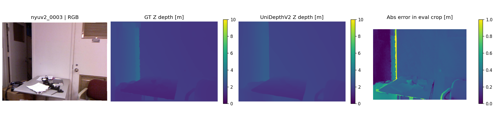

# UniDepthV2 ViT-S：NYUv2 开发样本试跑

2026-10-21，`nyuv2_0003`（标准 train，office_0003），官方 ViT-S，CPU float32、8 threads，resolution level=0。代码 `7b2150b4c61be2faaedd1fa820b03de2a0a4ab01`，运行时工作区干净。完整来源与环境见 [元数据](unidepth_week1_provenance.json)，运行命令见 [复现说明](../environments/unidepth.md)。

| Coverage | AbsRel | SqRel | RMSE | RMSE-log（ln） | δ1 | δ2 | δ3 |
| ---: | ---: | ---: | ---: | ---: | ---: | ---: | ---: |
| 100% | 0.163188 | 0.055342 m | 0.298850 m | 0.168232 | 0.865216 | 0.995884 | 0.999962 |

固定 NYUv2 crop 与 [0.001,10] m GT 范围；输出为相机 Z 米制深度，没有 GT scale/shift alignment。原始 float32 预测与 bool mask 在本地 `outputs/unidepth_nyuv2_0003_week1_20261021/`，完整精度指标见 [CSV](tables/unidepth_week1_nyuv2_0003.csv)。

预热一次后官方 `infer` 单次耗时 **1.1207 s（CPU）**，实际编码器输入 434×574，返回原图 480×640。这是流程试跑，不是 654 张测试集结果，也不是稳定吞吐量或 GPU 显存测量。

可见门边和桌沿处误差偏大；大块平面整体连续。图使用固定色标，没有按每张预测归一化。此观察不替代多样本评测。

已验证：官方权重 SHA256 正确，strict state load 成功；保存结果经统一 CLI 重新载入后各项指标精确一致；真实 NYUv2 GT 作为预测时，七指标分别为 0/1，coverage=100%。B 的独立复现及 DA V2 真实预测交接仍待完成。
